# Arbitraje estadístico multiactivo con cointegración y filtros de Kalman

**Lab03 · Microestructuras y Sistemas de Trading · ITESO** — Equipo 6: Gonzalo Cano y Juan Manuel Espinosa ·
noviembre de 2026

Fuente de cada cifra: `artifacts/` (lo genera `python main.py`) y `docs/decisiones.md`. Alcance: Lab03 completo sin
la sección 3.7 (Risk Parity), por indicación del profesor.

## Resumen ejecutivo

- **Grupo:** la tercia **GLD-GDX-B** (ETF de oro, ETF de mineras de oro y Barrick), cointegrada en entrenamiento
  (traza 35.8 contra 29.8 al 95 %, rango 1, vida media del spread 29 días).
- **Modelo:** Johansen da el vector inicial; el **filtro de Kalman 1** deja que los pesos deriven despacio; el
  **filtro de Kalman 2** convierte el término de corrección de error (ECT) en un z-score con estadísticos *prior*; una
  regla de bandas con stop y holding máximo decide la dirección; el backtest cobra comisión por pata y préstamo de
  cortos.
- **Resultado (θ congelado desde train, walk-forward):** Sharpe neto **0.66 / 0.74 / 1.01** en entrenamiento /
  prueba / validación, rendimiento +20.5 % / +8.1 % / +11.2 %, drawdown máximo −6.6 % / −4.5 % / −3.7 %. Total
  encadenado 2013–2026: +44.8 %, Sharpe 0.75. Los costos se llevan 21–25 % del P&L bruto.
- **Lectura honesta:** la relación **se debilita sin romperse** fuera de muestra y el filtro 1 absorbe la deriva.
  El grupo se eligió en una segunda iteración, después de que el primero (GLD-GDX-AEM-FNV) perdiera la cointegración
  en validación; corrigiendo por los 19 grupos candidatos, el Sharpe deja de ser estadísticamente concluyente
  (Sharpe deflactado ≈ 0.46). La relación tiene fundamento económico, pero la evidencia de que sea explotable es
  moderada.

## 1. Universo, justificación económica y pruebas múltiples

**Datos.** Precios ajustados diarios de Yahoo Finance del 2012-01-03 al 2026-10-30 (≈ 14.8 años), guardados en un
snapshot versionado (`data/snapshot/`) para que la corrida no dependa de la descarga. Partición 60/20/20 por fecha,
calculada una vez y congelada: **entrenamiento** 2012-01-03 → 2020-11-19, **prueba** 2020-11-20 → 2023-11-08,
**validación** 2023-11-09 → 2026-10-30. Forward-fill de máximo 3 días y nunca back-fill.

**Universos con justificación económica (criterio fijado antes de correr).**

- *Iteración 1:* petroleras de EE. UU. y Europa (126 cuartetos) y oro + mineras (70 cuartetos), grupos de 4 = 2 ×
  integrantes. Resultado: GLD-GDX-AEM-FNV.
- *Iteración 2 (autorizada por el profesor):* solo oro + mineras (GLD, GDX, NEM, AEM, KGC, B, AU, FNV), con pares,
  tercias y cuartetos: 154 grupos. Resultado: **GLD-GDX-B**. El metal, el ETF de mineras y una de sus posiciones más
  grandes comparten la tendencia casi de forma mecánica: las mineras son una opción apalancada sobre el precio del
  oro y GDX es una canasta de ellas. AEM y FNV (regalías) tienen dinámicas propias que pueden separarse del oro por años.

**Pruebas múltiples.** En total se probaron **280 grupos distintos**. En la iteración 2, Johansen rechaza r = 0 al
95 % en 30 de 154 grupos cuando por azar se esperarían 7.7; solo 4 rechazan al 99 % y la corrección de Bonferroni
exigiría α = 0.00032.
Por eso el embudo no se queda en Johansen: exige correlación, un vector con ADF significativo y una vida media
operable, y el reporte declara el sesgo de selección (sección 9).

## 2. Embudo de selección (iteración 2)

| Etapa (eliminatoria) | Criterio | Grupos que siguen |
|---|---|---|
| Universo | pares, tercias y cuartetos de 8 tickers | 154 |
| 2. Correlación | media de correlaciones móviles (252 días) > 0.7 | 136 (18 fuera) |
| 3. Engle–Granger | prioriza, no elimina (6 pares, regresión del grupo, bandera de regresión espuria) | 136 |
| 4. Johansen (traza 95 %) | rechaza r = 0 | 28 (108 fuera) |
| 6. Vector operable | ADF del spread p < 0.05 y vida media en [5, 60] días | **19** (9 fuera) |
| 7. Estabilidad | Johansen en cada mitad de train y móvil: se reporta, no elimina | 19 |

Entre los 19, la regla de la iteración 1 (máxima razón traza / crítico) elegiría KGC-B (1.33); GLD-GDX-B es el 4.º
(1.20). La tabla completa, con la etapa y el motivo de descarte de cada grupo, está en `artifacts/selection_table.csv`.

## 3. Johansen: rango, vector, ADF y vida media

Todas las series son I(1) (ADF en niveles p = 0.69 / 0.19 / 0.20, en diferencias p ≈ 0). Johansen con constante sin
restringir (`det_order = 0`), k_ar_diff = 1 elegido por BIC, 2 237 observaciones de train:

| H₀ | Traza | Crítico 95 % | Máx. eigenvalor | Crítico 95 % | Decisión |
|---|---|---|---|---|---|
| r = 0 | 35.82 | 29.80 | 27.54 | 21.13 | rechaza (traza también al 99 %: 35.46) |
| r ≤ 1 | 8.28 | 15.49 | 7.19 | 14.26 | no rechaza |
| r ≤ 2 | 1.09 | 3.84 | 1.09 | 3.84 | no rechaza |

Rango 1 por traza y por máximo eigenvalor (eigenvalores 0.0122, 0.0032 y 0.0005): solo el primer vector es
estacionario, así que no hay otro con qué competir. **Normalización** sobre la pata de mayor |peso| (GDX = +1):

> ECT_t = ln GDX_t − 0.827 ln GLD_t − 0.448 ln B_t − c, con c = −2.066 (media en train).

**Convención de signo:** largo el spread = comprar los activos con β̃ > 0 (GDX) y vender los de β̃ < 0 (GLD y B).
ADF del spread p = 0.0009; vida media −ln 2 / λ = **29.1 días**. El Johansen móvil de 2 años (figura 4) rechaza
r = 0 solo en 14 % de las ventanas de train: con ventanas cortas tiene poca potencia, y los pesos se mueven aun
dentro de train. Ese es el argumento para el filtro 1.

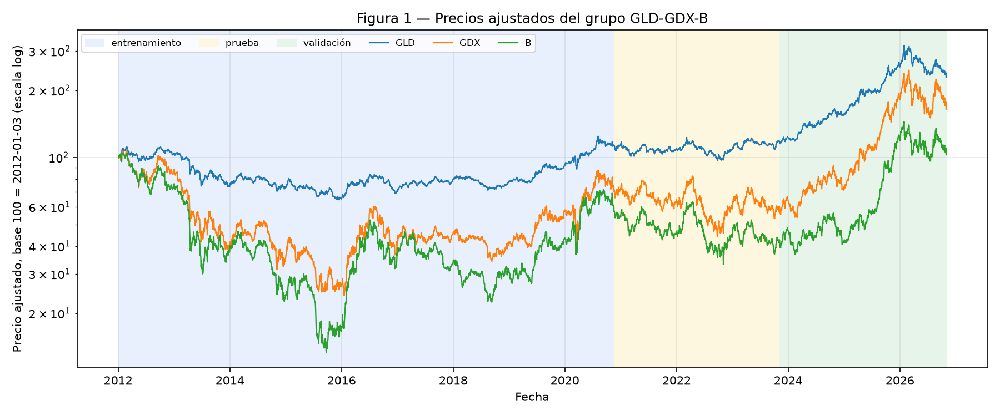

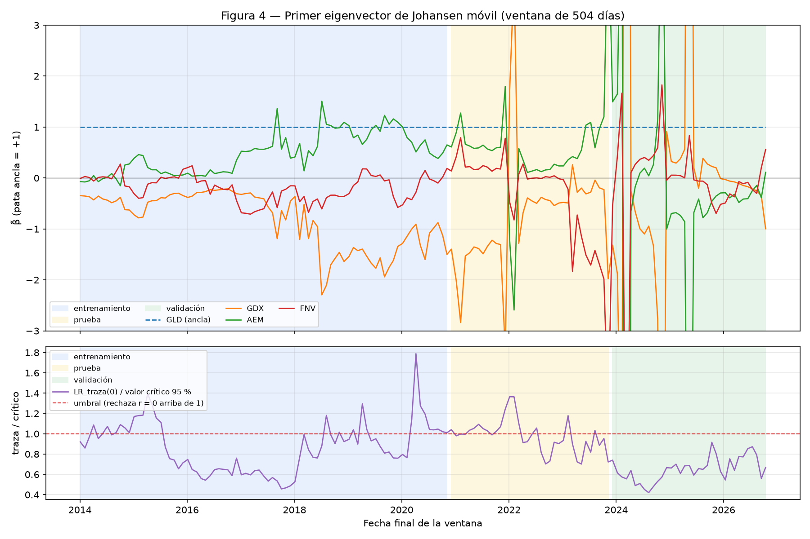

## 4. Formulación como proceso de decisión secuencial (Powell)

La formulación completa de cada filtro y del sistema (6 pasos, 5 elementos, ganancia de Kalman, Q y R, y ejemplo
numérico trabajado) está en el **Apéndice A**. Resumen:

| | Filtro 1 (pesos) | Filtro 2 (z-score) | Sistema completo |
|---|---|---|---|
| Estado | creencia (ĉ, β̂_GLD, β̂_B), P_t | creencia (μ̂, x̂), P_t | físico: acciones, efectivo, d_{t−1}, h_t, rearme · información: P_t, ECT_t, z_t · creencia: la de ambos filtros |
| Transición | caminata aleatoria, Q = q·I | μ caminata aleatoria, x AR(1) con φ | filtros + ejecución en t + 1 con costos |
| Observación | ln GDX_t = (1, −ln GLD_t, −ln B_t) z_t + v_t | ECT_t = μ_t + x_t + v_t | solo precios P_{t+1} (W_{t+1}) |
| Política | regla de Kalman (PFA, θ = Q, R) | regla de Kalman (PFA, θ = φ, q_μ, q_x, r) | regla de bandas (PFA, θ = z_entrada, z_salida, z_stop, h_max) + sizing |
| Objetivo | error de predicción con deriva lenta | verosimilitud de innovaciones con media lenta | máx. Sharpe neto en train |

**Ganancia de Kalman.** En el filtro 1, C_t K_t = 1 − R/S_t es la fracción de la sorpresa del día que se absorbe
moviendo pesos: mediana 0.0038 en train (0.4 %). En el filtro 2 converge a K^μ ≈ 0.08 y K^x ≈ 0.74: casi toda
sorpresa va a la desviación que revierte y muy poca a la media (figura 5).

## 5. Calibración: Q, R, inicialización, burn-in, normalización y signo

**Filtro 1.**

- R = 3.31 × 10⁻³, la varianza del residual de Johansen en train.
- q = 1.6 × 10⁻⁹ (q/R ≈ 4.8 × 10⁻⁷) por **separación de escalas**: es el mayor q con el que el filtro absorbe a lo
  más 20 % de una desviación en 2 vidas medias (58 días).
- Por qué no máxima verosimilitud: elige un q mucho mayor, y entonces el ECT revierte por el filtro y no por los
  precios.
- P₀ = 252·Q. El estado arranca en el β̃ de Johansen. Burn-in de 252 días (2012).
- El ECT de t se calcula con los pesos **prior** β̂_{t|t−1}: es la innovación del filtro y no está encogida por la
  actualización del día.

**Filtro 2.**

- φ = 0.969 (vida media 22.1 días, AR(1)/OU del ECT en train).
- q_x = 1.1 × 10⁻⁴ y r = 2.8 × 10⁻⁵ por máxima verosimilitud.
- q_μ = 9.3 × 10⁻⁷ por el mismo criterio de separación de escalas que el filtro 1.
- μ̂₀ = x̂₀ = 0, P₀ = diag(q_x/(1−φ²)); burn-in de 63 días.
- `z_t = (ECT_t − μ̂_{t|t−1}) / σ̂_{t|t−1}`, con σ̂² = q_x/(1−φ²) + p^μ + r, todo **prior**.
- Prueba 4 en train: varianza de ν/√S = 0.995 y Ljung–Box del rezago 1 con p = 0.62.

**Normalización y signo:** ancla GDX = +1 en Johansen, en el estado del filtro 1 (GDX no es estado: es la variable
observada) y en el sizing (N_i ∝ |β̂_i| con el signo de β̂_i).

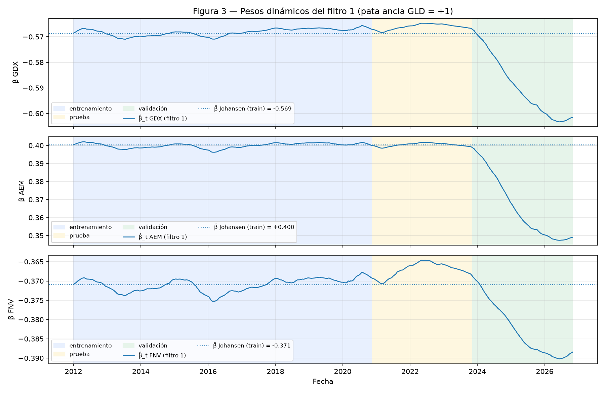

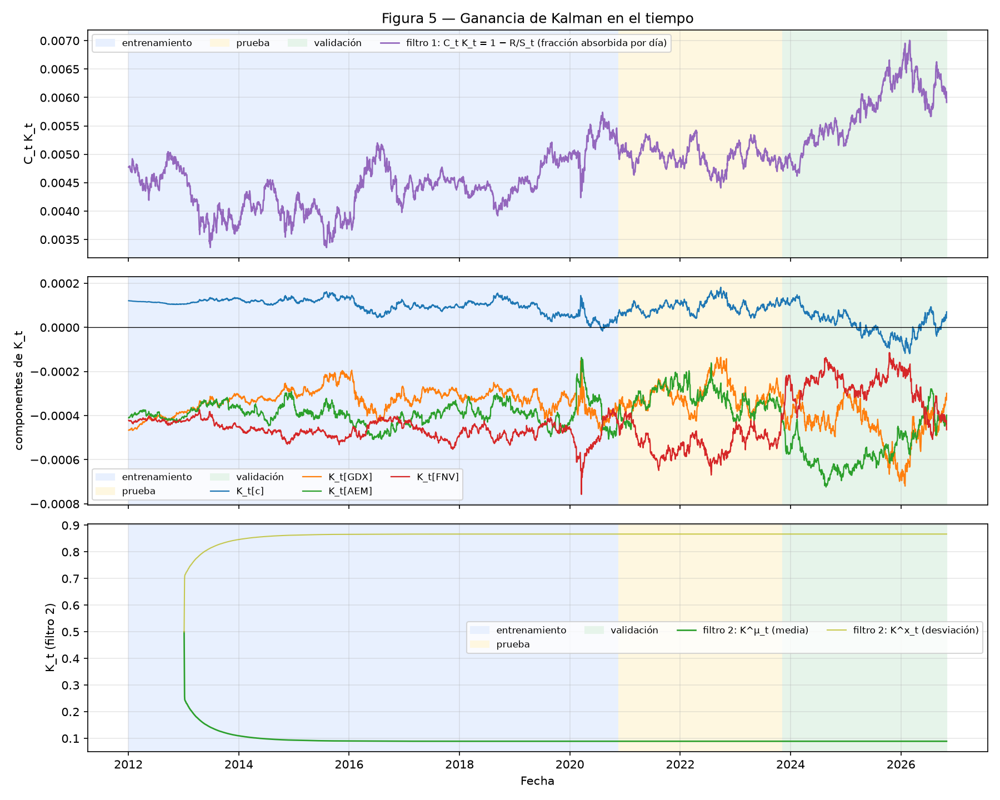

## 6. VECM: α y su interpretación

VECM en train con constante sin restringir, rango 1 y k_ar_diff = 1; su β coincide con el de Johansen.

| | GLD | GDX | B |
|---|---|---|---|
| α | −0.003 | **−0.039** | **−0.034** |
| t | −0.9 | −4.1 | −3.4 |

βᵀα = −0.021 cumple −2 < βᵀα < 0 (la relación corrige), con vida media de 33.3 días. Solo GDX corrige: su
contribución β_GDX·α_GDX = −0.039 cierra el spread, mientras que la de Barrick (β_B·α_B = +0.015) lo abre. Cuando
el ETF de mineras se encarece frente al oro y a Barrick, es el ETF el que regresa; el oro casi no participa en el
ajuste. Las tres vidas medias (Johansen 29.1, VECM 33.3, filtro 2 22.1 días) coinciden en orden de magnitud.

## 7. Umbrales y procedimiento de búsqueda

**Regla (PFA).**

- Plano: largo si −z_stop < z_t < −z_entrada; corto si z_entrada < z_t < z_stop.
- Con posición, cierra con esta prioridad: stop (|z_t| ≥ z_stop) > holding (h_t ≥ h_max) > salida direccional.
- Tras un stop o un holding, esa dirección se rearma solo cuando |z_t| < z_entrada.
- Se ejecuta al cierre de t + 1 con N_i = 0.8 V |β̂_i| / Σ|β̂_j|, con el valor V del portafolio antes de operar ese día.

**Búsqueda.** El grid se registró en `docs/decisiones.md` antes de ver resultados:

- z_entrada ∈ {1, 1.25, 1.5, 1.75, 2, 2.5}, z_salida ∈ {0, 0.25, 0.5}, z_stop ∈ {2.5, 3, 3.5, 4} y
  h_max = k · 29 días con k ∈ {1, 2, 3}.
- Hay 207 combinaciones válidas (z_salida < z_entrada < z_stop); 135 tienen al menos 10 operaciones.
- Objetivo: Sharpe neto anualizado en train, con la simulación completa y los costos.
- Resultado: **θ = (1.0, 0.0, 2.5, 87 días)**, con Sharpe 0.66 y 24 operaciones en train.
- El 83 % de las combinaciones tiene Sharpe positivo en train, y las 5 mejores comparten z_entrada = 1 y z_salida = 0.
- Limitación: el óptimo está en el borde de la rejilla, que no se amplió, y el Sharpe deflactado del grid en train
  es 0.59.
- Fuera de muestra, ese θ es el 13.º de 135 en prueba y el 1.º en validación. La correlación de Spearman entre el
  Sharpe de train y el de fuera de muestra es 0.49 (prueba) y 0.43 (validación).

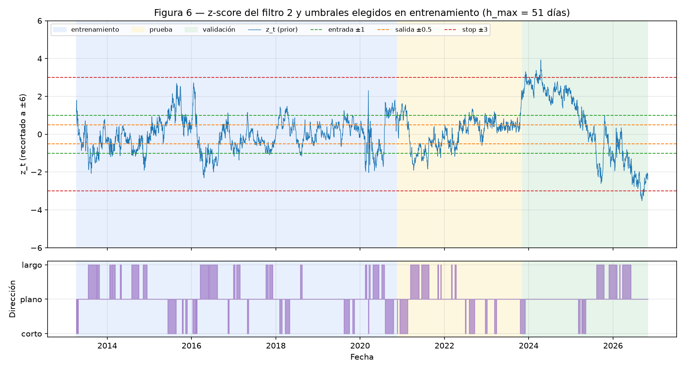

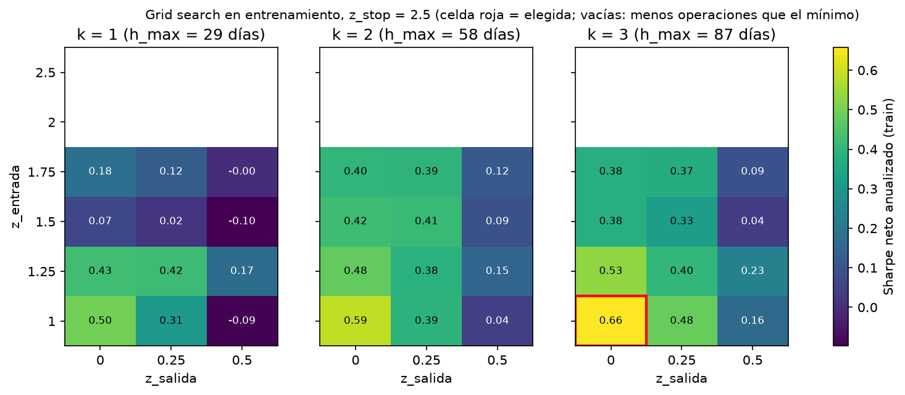

## 8. Resultados por partición, costos y rebalanceo

| Métrica | Entrenamiento | Prueba | Validación | Total (encadenado) |
|---|---|---|---|---|
| Periodo | 2013-04 → 2020-11 | 2020-11 → 2023-11 | 2023-11 → 2026-10 | 2013-04 → 2026-10 |
| Rendimiento neto | +20.5 % | +8.1 % | +11.2 % | +44.8 % |
| CAGR | 2.5 % | 2.7 % | 3.7 % | 2.8 % |
| Sharpe neto | 0.66 | 0.74 | 1.01 | 0.75 |
| Sortino | 1.01 | 1.12 | 1.61 | 1.16 |
| Calmar | 0.38 | 0.59 | 0.98 | 0.42 |
| Max drawdown | −6.6 % | −4.5 % | −3.7 % | −6.6 % |
| Racha más larga bajo el máximo (días hábiles) | 1 185 | 244 | 171 | 1 185 |
| Operaciones / ganadoras | 24 / 79 % | 9 / 89 % | 11 / 91 % | 44 / 84 % |
| Profit factor | 2.49 | 4.55 | 8.11 | 3.26 |

Cada partición arranca con $1,000,000 y el CAGR es bajo porque solo 80 % del capital está invertido y la estrategia
está en el mercado menos de la mitad de los días. En las tres particiones suman $522,687 de P&L bruto, $118,744 de
comisiones y $6,067 de préstamo, para $397,876 netos: los costos son el 24 % del bruto. Por año, 13 de 14 años son
positivos; el único negativo es 2016 (−5.3 %).

**Rebalanceo diario contra banda de no-rebalanceo** (θ fijo; la política oficial es el diario, con el que se eligió θ):

| Banda | Sharpe train | Sharpe prueba | Sharpe validación | Rebalanceos train | Comisiones train |
|---|---|---|---|---|---|
| diario (0) | 0.66 | 0.74 | 1.01 | 697 | $66,527 |
| 5 % | 0.69 | 0.72 | 0.99 | 146 | $59,671 |
| 10 % | 0.66 | 0.83 | 1.07 | 45 | $56,077 |
| 20 % | 0.66 | 0.82 | 1.12 | 9 | $54,579 |

En train la banda casi no cambia el Sharpe, pero ahorra hasta 18 % de comisiones. Elegir la banda de 20 % por lo que
pasa en prueba y validación sería ajustar con esos datos, así que se reporta como escenario.

**Estático contra dinámico** (mismo θ): con el ECT estático de Johansen el Sharpe es 0.72 / 0.20 / 1.31; con el
dinámico, 0.66 / 0.74 / 1.01. El estático se cae en prueba, donde su ECT deja de ser estacionario (ADF p = 0.27).
El dinámico es más consistente entre particiones porque absorbe la deriva de nivel de la relación.

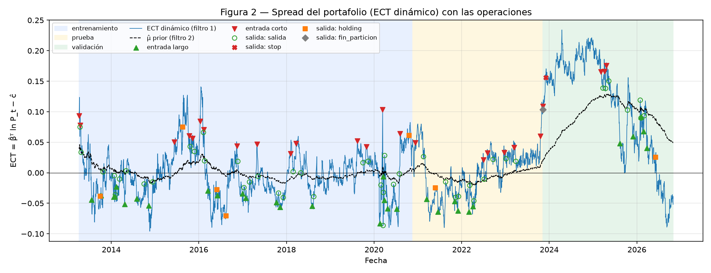

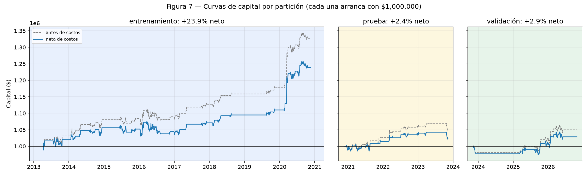

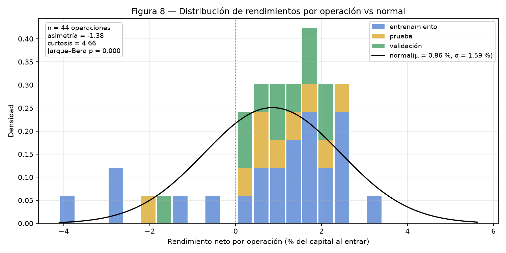

La distribución por operación tiene sesgo −1.38 y curtosis 4.66 (Jarque–Bera p = 7.6 × 10⁻⁵): muchas ganancias
pequeñas por reversión y pocas pérdidas grandes por stop y holding. Ninguna operación cerrada por reversión perdió.

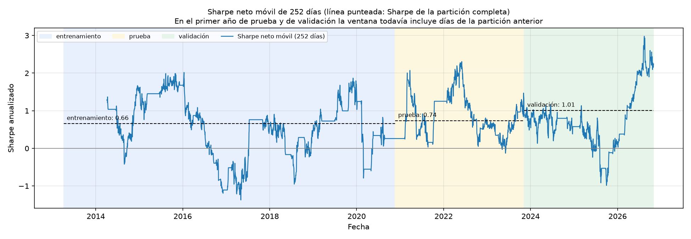

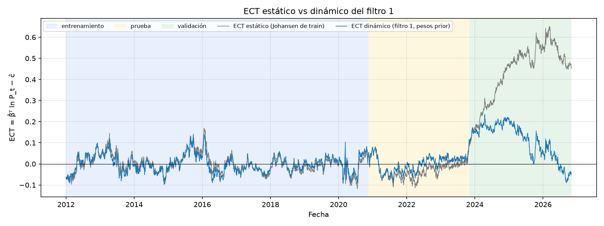

## 9. ¿Relación estructural o artefacto?

**Argumentos a favor de una relación estructural.**

1. **Mecanismo económico directo:** GDX es una canasta de mineras de oro y Barrick está entre sus mayores
   posiciones; las tres series dependen del precio del oro.
2. **El VECM confirma la corrección de error** (βᵀα = −0.021), con el ajuste en el activo esperado (GDX).
3. **Fuera de muestra la relación se debilita pero no se rompe.** El ECT estático se desplaza en promedio
   1.2 / 1.9 desviaciones de train en prueba / validación, contra ≈ 10 del grupo de la iteración 1. El dinámico se
   mantiene centrado (media −0.02 / +0.003; ADF p = 0.055 / 0.011).
4. **La estrategia gana en todos los años fuera de muestra.** Tiene 18 de 20 operaciones ganadoras y +$122 mil aun
   sin sus 3 mejores operaciones. No toca el stop fuera de muestra.

**Argumentos a favor de que parte del resultado es artefacto.**

1. **Pruebas múltiples:** 30 de 154 grupos rechazan r = 0 cuando se esperaban 7.7 por azar, y solo 4 rechazan al
   99 % (Bonferroni exigiría α = 0.00032).
2. **Sesgo de selección:** la tercia se eligió en una segunda iteración, con lo aprendido de prueba y validación.
   Con el mismo pipeline, los 19 sobrevivientes tienen una mediana de Sharpe fuera de muestra de 0.21. GLD-GDX-B es
   el 1.º de 19, y la correlación entre el Sharpe de train y el de fuera de muestra a través de los grupos es −0.29.
   El **Sharpe deflactado** (N = 19) es ≈ 0.46.
3. **Inestabilidad:** el Johansen móvil rechaza poco (14 % de las ventanas de train), y en la prueba anidada
   (train partido 60/20/20) esta familia de grupos da Sharpe negativo en 2017–2020.
4. **Sensibilidad:** con tolerancias de los filtros de 10 % o 40 % en lugar de 20 %, el Sharpe fuera de muestra
   baja a 0.17–0.69 contra 0.87. Los hiperparámetros de la optimización, en cambio, son robustos.

**Conclusión.** La relación GLD-GDX-B es **estructural en su origen pero inestable en sus pesos**: existe un vector
que corrige, con fundamento económico, cuyo nivel y pesos derivan con los años. La estrategia funciona porque el
filtro 1 sigue esa deriva. Que este grupo en particular sea el mejor y que el Sharpe fuera de muestra sea ≈ 0.9 no
es estadísticamente concluyente después de corregir por la búsqueda. En operación real se usaría con la regla de
monitoreo y apagado del post-mortem (`project_management/postmortem.md`).

## 10. Supuestos y limitaciones

- **Supuestos de mercado:**
    - Se opera al precio de cierre de t + 1 sin slippage ni impacto.
    - Comisión de 0.125 % por pata y préstamo de 0.25 % anual sobre el nocional corto, siempre disponible.
    - El efectivo no rinde intereses (r_f = 0).
- **Datos:**
    - Precios ajustados de Yahoo.
    - Sesgo de supervivencia: solo se excluyen empresas adquiridas.
    - Universos elegidos por el equipo.
- **Modelo:**
    - Johansen supone una sola relación lineal en log-precios con constante.
    - Los filtros suponen ruido gaussiano.
    - Q, R, φ y θ están congelados desde train; no hay recalibración, porque la recalibración probada no mejoró
      fuera de muestra de forma consistente.
    - Fuera de muestra la varianza de las innovaciones del filtro 2 baja a 0.51 / 0.58: el filtro sobreestima el ruido
      y es conservador.
- **Estadística:**
    - Hay pocas operaciones (9 y 11 fuera de muestra), así que el Sharpe tiene mucho error.
    - Ljung–Box a 5–10 rezagos rechaza con cualquier modelo del filtro 2.
    - El grid tiene su óptimo en el borde.
- **Proceso:** dos iteraciones de selección. La segunda la autorizó el profesor y está documentada completa en
  `docs/decisiones.md`, incluidas las pruebas que no funcionaron (prueba anidada, hiperparámetros, recalibración y
  un solo sector).
- **Excluido del alcance:** Risk Parity entre grupos (sección 3.7), operación en vivo y datos intradía.

## Apéndice A. Formulación completa como proceso de decisión secuencial

Cada formulación sigue los 6 pasos y los 5 elementos del marco de Powell, con el nombre de la función o variable del código junto a cada elemento. La notación es la de `docs/notas_clase/`.

### A.1 Filtro 1 — pesos dinámicos del vector cointegrante

Código: `kalman/weights_filter.py`. Grupo GLD-GDX-B (iteración 2), pata ancla GDX (peso fijo +1), P_t = log-precios.

#### Proceso de 6 pasos

1. **Problema.** Estimar cada día el vector de pesos del portafolio estacionario β_t (y su intercepto c_t), que
   puede derivar con el tiempo, a partir de log-precios observados con ruido. De ahí sale el término de corrección
   de error ECT_t que usa el filtro 2.
2. **Estado.** z_t = (c_t, β_t^{GLD}, β_t^{B})ᵀ. GDX no es parte del estado: su peso vale +1 en la
   ecuación de observación (normalización de Johansen), lo que identifica el estado.
3. **Transición.** Caminata aleatoria: z_t = z_{t−1} + w_t, w_t ~ N(0, Q), Q = q·I.
4. **Observación.** P_t^{GDX} = (1, −P_t^{GLD}, −P_t^{B}) z_t + v_t, v_t ~ N(0, R).
5. **Política.** La regla de actualización de Kalman: ẑ_{t|t} = ẑ_{t|t−1} + K_t ỹ_t con
   K_t = P_{t|t−1} C_tᵀ / S_t. Es una **PFA** (función de política paramétrica) con θ = (Q, R); la optimización
   de la regla se hizo una vez, analíticamente, al derivar K_t.
6. **Aprendizaje.** θ se calibra con entrenamiento: R = varianza de los residuales de Johansen; q es el mayor
   valor con el que el filtro absorbe a lo más 20 % de una desviación durante una operación típica (2 vidas medias).
   La creencia (ẑ_t, P_t) se actualiza cada día con el ciclo predecir → actualizar.

#### 5 elementos

| Elemento | Definición | En el código |
|---|---|---|
| Variables de estado S_t | Información I_t = log-precios P_t; creencia B_t = (ẑ_{t\|t}, P_{t\|t}). No hay estado físico: el filtro no tiene posiciones | `log_prices`, `WeightsFilter.state`, `WeightsFilter.P_cov` |
| Decisión x_t | La corrección aplicada a la creencia: x_t = K_t ỹ_t | `update()` |
| Información exógena W_{t+1} | El vector de log-precios del día siguiente | fila de `log_prices` |
| Transición S^M(S_t, x_t, W_{t+1}) | Predecir: ẑ_{t+1\|t} = ẑ_{t\|t}, P_{t+1\|t} = P_{t\|t} + Q. Actualizar: ỹ, S, K, ẑ_{t+1\|t+1}, P_{t+1\|t+1} | `predict()`, `update()` |
| Función objetivo | min_π E[Σ ỹ_t²] (error de predicción de un paso), sujeto a que la deriva de los pesos sea lenta frente a la reversión del spread | criterio de `calibrate_q` |

#### Ganancia de Kalman: cálculo e interpretación

- K_t es un vector de 3 componentes (una por estado). Su versión escalar es C_t K_t = 1 − R/S_t: la fracción de
  la sorpresa del día que el filtro absorbe moviendo pesos. En train vale ≈ 0.0038 (mediana): el filtro corrige
  0.38 % de cada sorpresa y deja el resto para que la corrijan los precios.
- Q → 0: K_t → 0, el filtro es el vector estático de Johansen. R → ∞: igual, ignora las observaciones. Q grande
  frente a R: K_t grande, los pesos persiguen al spread y el ECT revierte por construcción (sin poder predictivo).
- En validación C_t K_t sube a ≈ 0.004–0.006: crece la incertidumbre P_t.

#### Q y R justificados

- R = 3.31 × 10⁻³: varianza de β̃ᵀ ln P_t − c en train (lo que el vector de Johansen no explica).
- q = 1.6 × 10⁻⁹ (q/R ≈ 4.8 × 10⁻⁷) por separación de escalas: con w̄ = 0.0038 diario, en 58 días (2 vidas medias)
  se absorbe 1 − (1 − 0.0038)^{58} ≈ 20 %. Se descartó máxima verosimilitud porque elige q mucho mayor (en la
  iteración 1, q ≈ 10⁻⁶ con un ECT de vida media de 3–4 días que revierte por el filtro, no por los precios).
- P₀ = 252·Q y burn-in de 252 días (2012).

#### Ejemplo numérico

Son los primeros 5 días después del burn-in de 252 días, con los valores de `artifacts/kf1_weights.parquet`.
Parámetros: q = 1.598 × 10⁻⁹ y R = 3.313 × 10⁻³. El notebook 03 además reproduce el ejemplo 1 de la sesión 13 con la misma clase.

**Prior e innovación.**

| Fecha | β̂\_GLD prior | β̂\_B prior | ĉ prior | ỹ_t = ECT_t | S_t (× 10⁻³) |
|---|---|---|---|---|---|
| 2013-01-04 | −0.833943 | −0.453059 | −2.064510 | 0.032172 | 3.32727 |
| 2013-01-07 | −0.833962 | −0.453070 | −2.064507 | 0.025100 | 3.32721 |
| 2013-01-08 | −0.833976 | −0.453079 | −2.064504 | 0.030694 | 3.32719 |
| 2013-01-09 | −0.833994 | −0.453090 | −2.064500 | 0.023061 | 3.32720 |
| 2013-01-10 | −0.834007 | −0.453099 | −2.064498 | 0.026809 | 3.32730 |

**Ganancia y posterior.**

| Fecha (2013) | K^c (× 10⁻⁴) | K^GLD (× 10⁻⁴) | K^B (× 10⁻⁴) | C_t K_t | β̂\_GLD post. | β̂\_B post. | ĉ post. | Var. post. β_GLD (× 10⁻⁷) |
|---|---|---|---|---|---|---|---|---|
| 01-04 | 1.143 | −5.786 | −3.647 | 0.00425 | −0.833962 | −0.453070 | −2.064507 | 5.1427 |
| 01-07 | 1.146 | −5.785 | −3.621 | 0.00423 | −0.833976 | −0.453079 | −2.064504 | 5.1475 |
| 01-08 | 1.146 | −5.805 | −3.582 | 0.00423 | −0.833994 | −0.453090 | −2.064500 | 5.1523 |
| 01-09 | 1.146 | −5.803 | −3.589 | 0.00423 | −0.834007 | −0.453099 | −2.064498 | 5.1571 |
| 01-10 | 1.141 | −5.802 | −3.638 | 0.00426 | −0.834023 | −0.453108 | −2.064495 | 5.1618 |

**Paso a paso del 2013-01-04.** Con ln GLD = 5.0779, ln GDX = 3.6917 y ln B = 3.2874:

1. Predicción: ln GDX esperado = ĉ − β̂\_GLD ln GLD − β̂\_B ln B = −2.0645 + 0.8339·5.0779 + 0.4531·3.2874 = 3.6596.
2. Innovación: ỹ_t = 3.6917 − 3.6596 = **0.0322**. Es el ECT dinámico que recibe el filtro 2.
3. Varianza de la innovación: S_t = C_t P_{t|t−1} C_tᵀ + R = 0.003327, apenas mayor que R = 0.003313.
4. Fracción absorbida: C_t K_t = 1 − R/S_t = **0.00425**, es decir, 0.43 % de la sorpresa.
5. Posterior: β̂\_GLD = −0.833943 + (−5.786 × 10⁻⁴)·0.0322 = **−0.833962**.

Cada día los pesos se mueven del orden de 10⁻⁵ y la varianza posterior crece poco a poco: la deriva es lenta, que es lo
que exige la separación de escalas.

### A.2 Filtro 2 — media y escala del ECT → z-score

Código: `kalman/signal_filter.py`. Entrada: ECT dinámico del filtro 1 (pesos prior) de la tercia GLD-GDX-B, desde 2013-01-04.

#### Proceso de 6 pasos

1. **Problema.** Estimar cada día la media latente del ECT y su escala para convertir el ECT en un z-score que diga
   qué tan lejos está el portafolio de su equilibrio, sin usar información del día para juzgar al día (z prior).
2. **Estado.** z_t = (μ_t, x_t)ᵀ: μ_t es la media lenta del ECT (nivel local de clase) y x_t la desviación que revierte.
   Se agrega x_t porque el ECT revierte en semanas (vida media ≈ 22 días en train) y el nivel local supone que toda
   desviación es ruido de un día: o persigue al spread o deja innovaciones autocorrelacionadas (`docs/decisiones.md`).
3. **Transición.** μ_t = μ_{t−1} + w^μ_t, x_t = φ x_{t−1} + w^x_t; A = diag(1, φ), Q = diag(q_μ, q_x).
4. **Observación.** ECT_t = μ_t + x_t + v_t, v_t ~ N(0, r); C = (1, 1).
5. **Política.** La regla de Kalman ẑ_{t|t} = ẑ_{t|t−1} + K_t ν_t, K_t = P_{t|t−1} Cᵀ / S_t: una **PFA** con
   θ = (φ, q_μ, q_x, r). La señal que sale es z_t = (ECT_t − μ̂\_{t|t−1}) / σ̂\_{t|t−1} con
   σ̂²_{t|t−1} = q_x / (1 − φ²) + p^μ_{t|t−1} + r, calculada **antes** de actualizar.
6. **Aprendizaje.** θ se calibra con entrenamiento: φ del AR(1)/OU del ECT; q_x y r por máxima verosimilitud;
   q_μ por separación de escalas (μ̂ absorbe a lo más 20 % de un desplazamiento en 2 vidas medias, el mismo criterio
   del filtro 1). La creencia se actualiza cada día con predecir → actualizar.

#### 5 elementos

| Elemento | Definición | En el código |
|---|---|---|
| Variables de estado S_t | Información I_t = ECT_t; creencia B_t = (μ̂\_{t\|t}, x̂\_{t\|t}, P_{t\|t}). No hay estado físico | `SignalFilter.state`, `SignalFilter.P_cov` |
| Decisión x_t | La corrección aplicada a la creencia: K_t ν_t | `update()` |
| Información exógena W_{t+1} | El ECT del día siguiente (lo produce el filtro 1 con los precios de t + 1) | `ect_dynamic` |
| Transición S^M(S_t, x_t, W_{t+1}) | Predecir: ẑ_{t+1\|t} = A ẑ_{t\|t}, P_{t+1\|t} = A P_{t\|t} Aᵀ + Q. Actualizar: ν, S, K, ẑ_{t+1\|t+1}, P_{t+1\|t+1} | `predict()`, `update()` |
| Función objetivo | min_π E[Σ ν_t²] (verosimilitud de las innovaciones para q_x y r), sujeto a que la media se mueva lento frente a la reversión del ECT (q_μ) | `fit_noise_mle`, `calibrate_q_mu` |

#### Ganancia de Kalman: cálculo e interpretación

- K_t = (K^μ_t, K^x_t): de cada sorpresa ν_t, qué fracción mueve la media y cuál la desviación. Con parámetros fijos y
  C constante converge a su estado estable: K^μ ≈ 0.08 y K^x ≈ 0.74 (figura 5, panel 3).
- K^μ es sobre la **sorpresa de un día**, no sobre la desviación: si el ECT queda desplazado de forma permanente, x̂
  absorbe primero y μ̂ solo toma ≈ 20 % del desplazamiento en 44 días.
- q_μ → 0: la media queda fija y z mide distancia a una constante. q_μ grande: μ̂ persigue al ECT y z deja de tener señal.

#### Q y R justificados

- φ = 0.969 (vida media 22.1 días, AR(1)/OU del ECT en train).
- q_x = 1.1 × 10⁻⁴ y r = 2.8 × 10⁻⁵ por máxima verosimilitud en train: casi todo el ruido diario es de la desviación
  (√(q_x / (1 − φ²)) ≈ 0.042, la dispersión del ECT) y muy poco es ruido de medición.
- q_μ = 9.3 × 10⁻⁷ por separación de escalas (la verosimilitud casi no depende de q_μ: no lo identifica).
- P₀ = diag(v_x, v_x), μ̂₀ = x̂₀ = 0; burn-in de 63 días.

#### Ejemplo numérico

Son los primeros 5 días después de ambos burn-in (252 + 63 días), con los valores de `artifacts/kf2_signal.parquet`.
El notebook 04 además reproduce el ejemplo 2 de la sesión 13: el día 4 el z prior (2.04) cruza z_entrada = 2 y el
posterior (1.82) no, porque el posterior ya absorbió el dato del día y lo juzga consigo mismo.

**Prior y z-score.**

| Fecha | ECT_t | μ̂ prior | x̂ prior | σ̂ prior | z_t (prior) | ν_t | S_t (× 10⁻⁴) |
|---|---|---|---|---|---|---|---|
| 2013-04-08 | −0.0648 | −0.0151 | −0.0446 | 0.0486 | −1.0230 | −0.0051 | 1.583 |
| 2013-04-09 | −0.0381 | −0.0159 | −0.0465 | 0.0486 | −0.4571 | 0.0243 | 1.583 |
| 2013-04-10 | −0.0233 | −0.0122 | −0.0293 | 0.0485 | −0.2290 | 0.0182 | 1.583 |
| 2013-04-11 | −0.0435 | −0.0094 | −0.0166 | 0.0485 | −0.7017 | −0.0175 | 1.583 |
| 2013-04-12 | −0.0219 | −0.0121 | −0.0274 | 0.0485 | −0.2031 | 0.0176 | 1.583 |

**Ganancia y posterior.**

| Fecha | K^μ | K^x | μ̂ post. | x̂ post. | Var. post. μ (× 10⁻⁴) | Var. post. x (× 10⁻⁴) | z posterior (solo diagnóstico) |
|---|---|---|---|---|---|---|---|
| 2013-04-08 | 0.1521 | 0.6691 | −0.0159 | −0.0480 | 6.028 | 6.175 | −1.0070 |
| 2013-04-09 | 0.1514 | 0.6697 | −0.0122 | −0.0302 | 6.001 | 6.148 | −0.5329 |
| 2013-04-10 | 0.1508 | 0.6704 | −0.0094 | −0.0171 | 5.975 | 6.122 | −0.2854 |
| 2013-04-11 | 0.1502 | 0.6710 | −0.0121 | −0.0283 | 5.948 | 6.096 | −0.6476 |
| 2013-04-12 | 0.1495 | 0.6716 | −0.0094 | −0.0156 | 5.922 | 6.070 | −0.2573 |

**Paso a paso del 2013-04-08.**

1. z-score con estadísticos prior: z_t = (ECT_t − μ̂\_{t|t−1}) / σ̂\_{t|t−1} = (−0.0648 − (−0.0151)) / 0.0486 = **−1.0230**. Como z_t < −z_entrada = −1, la regla decide abrir largo.
2. Innovación: ν_t = ECT_t − μ̂ − x̂ = −0.0648 − (−0.0151) − (−0.0446) = −0.0051.
3. Posterior de la media: μ̂ = −0.0151 + 0.1521·(−0.0051) = **−0.0159**.
4. Posterior de la desviación: x̂ = −0.0446 + 0.6691·(−0.0051) = **−0.0480**.

La mayor parte de cada sorpresa va a x̂, la desviación que revierte. K^μ todavía baja hacia su valor estable (≈ 0.08) y
K^x sube hacia el suyo (≈ 0.74) porque la incertidumbre inicial de μ se sigue reduciendo.

### A.3 Política de trading — regla de bandas sobre z_t

Código: `strategy/signals.py`, `strategy/optimization.py`. Insumo para el sistema completo.

- **Decisión.** d_t ∈ {−1, 0, +1}, la dirección del spread decidida al cierre de t. Se ejecuta al cierre de t + 1 con
  q_i = d_t · sgn(β̂\_i) · 0.8 V |β̂\_i| / (Σ|β̂\_j| P_i), donde β̂ es el posterior de t, y V (antes de operar) y P_i son los
  del cierre de t + 1.
- **Estado que usa la política.** z_t (sale de la creencia del filtro 2), la posición actual d_{t−1}, los días en la
  operación h_t y si cada dirección está armada. Estos dos últimos son parte del estado físico: sin ellos la regla
  no sabe cuándo cerrar por holding ni si puede reentrar.
- **Política.** PFA con θ = (z_entrada, z_salida, z_stop, h_max):
    - abre si z_entrada < |z_t| < z_stop;
    - cierra por stop, por holding o por salida direccional, con esa prioridad;
    - después de un stop o un holding, esa dirección se rearma cuando |z_t| < z_entrada.
- **Aprendizaje.** θ se elige con un grid search **en train** que maximiza el Sharpe neto de costos de la simulación
  completa (motor de la parte 06). Resultado con la tercia: θ = (1.0, 0.0, 2.5, 87 días) (iteración 1: (1.0, 0.5, 3.0, 51 días)). La rejilla y el objetivo se registraron
  antes de ver resultados (`docs/decisiones.md`).
- **Objetivo.** max_θ Sharpe(rendimientos netos de comisiones y préstamo) en train, con al menos 10 operaciones. Es la
  versión ajustada por riesgo de max E[Σ P&L neto] de la sesión 11.

### A.4 Sistema completo — filtro 1 + filtro 2 + VECM + trading

Código: `main.py` (etapas), `kalman/weights_filter.py`, `kalman/signal_filter.py`, `strategy/signals.py`,
`strategy/sizing.py`, `backtest/engine.py`, `backtest/costs.py`. Un día t es el cierre de mercado de t.

#### Proceso de 6 pasos

1. **Problema.** Decidir cada día si el portafolio GLD-GDX-B debe estar largo, corto o plano en el spread, y con
   cuántas acciones de cada activo, para maximizar la riqueza neta de comisiones y préstamo ajustada por riesgo, sin
   usar información que no se conoce al decidir.
2. **Estado.** S_t = (R_t, I_t, B_t), separado en físico, información y creencia (tabla de abajo).
3. **Transición.** Llega P_{t+1}: el filtro 1 predice, calcula el ECT con los pesos prior y actualiza; el filtro 2
   calcula z_{t+1} con sus estadísticos prior y actualiza; el motor ejecuta al cierre de t + 1 la decisión de t, cobra
   comisión y préstamo y revalúa el portafolio.
4. **Observación.** Solo se observan precios. ECT_t y z_t no son observaciones nuevas: son funciones de P_t y de la
   creencia prior (estadísticos suficientes recursivos).
5. **Política.** X^π(S_t | θ) = (d_t, N\*\_t), una **PFA** en dos niveles: la regla de bandas da la dirección d_t y el
   sizing da las acciones objetivo. Los filtros son a su vez PFA para la creencia (regla de Kalman con θ_KF).
6. **Aprendizaje.** θ_KF = (q, R, φ, q_μ, q_x, r) y θ = (z_entrada, z_salida, z_stop, h_max) se calibran una sola vez en
   train y quedan congelados (walk-forward); la creencia se actualiza cada día. El VECM (train) no entra a la
   política: valida que el vector corrige (βᵀα = −0.021) y da una tercera vida media (33.3 días).

#### 5 elementos

| Elemento | Definición | En el código |
|---|---|---|
| **Estado físico** R_t | acciones N_{i,t} de GLD, GDX y B; efectivo C_t; valor V_t = C_t + Σ N_{i,t} e^{P_{i,t}}; dirección vigente d_{t−1}; días en la operación h_t; dirección armada o desarmada tras un stop o holding | `engine.run_backtest` (`shares`, `cash`, `equity`), `signals.generate_signals` (`holding_days`, rearme) |
| **Información** I_t | log-precios P_t; ECT_t = ỹ_t (innovación del filtro 1 con pesos prior); z_t; θ y parámetros de costos congelados | `log_prices`, `ect_dynamic`, `zscore`, `params.json` |
| **Creencia** B_t | filtro 1: ẑ_t = (ĉ_t, β̂\_t^{GLD}, β̂\_t^{B}) y P_t; filtro 2: (μ̂\_t, x̂\_t) y su P_t; escala σ̂\_{t\|t−1} | `kf1_weights.parquet`, `kf2_signal.parquet` |
| **Decisión** x_t | d_t ∈ {−1, 0, +1} y acciones objetivo N\*\_{i,t} = d_t · sgn(β̂\_i) · 0.8 V \|β̂\_i\| / (Σ_j \|β̂\_j\| · e^{P_i}), con β̂ posterior de t; se ejecutan al cierre de t + 1 con V (antes de operar) y P_i de ese cierre | `signals.generate_signals`, `sizing.target_shares` |
| **Información exógena** W_{t+1} | el vector de precios P_{t+1}; nada más es aleatorio en el sistema | fila de `prices` |
| **Transición** S^M | creencia: predecir/actualizar filtro 1 → ECT_{t+1} → predecir/actualizar filtro 2 → z_{t+1}. Físico: ΔN = N\*\_t − N_t (con banda de no-rebalanceo b); C_{t+1} = C_t − Σ ΔN_i e^{P_{i,t+1}} − 0.125 % Σ \|ΔN_i\| e^{P_{i,t+1}} − (0.25 % / 252) Σ_{cortos} \|N_i\| e^{P_{i,t+1}}; h y el rearme se actualizan con la regla | `WeightsFilter`, `SignalFilter`, `engine.run_backtest`, `costs.commission_cost`, `costs.borrow_cost` |
| **Objetivo** | max_θ F^π(θ) = Sharpe neto anualizado de los rendimientos diarios r_t = V_{t+1} / V_t − 1 en train (r_f = 0, √252), con al menos 10 operaciones; versión ajustada por riesgo de max E[Σ_t P&L neto_t] | `optimization.grid_search`, `best_rule` |

#### Ganancia de Kalman, Q y R

El sistema no agrega ganancias ni matrices propias: usa las de los dos filtros (cálculo e interpretación de K_t en A.1 y A.2; Q y R en esas mismas secciones y en la sección 5). La figura 5 muestra K_t de ambos filtros en toda la muestra.

#### Ejemplo numérico

Es la primera operación del backtest, del 2013-04-09 al 2013-04-16 (`signals.parquet`, `equity_curve.parquet` y
`trades.csv`). Los cinco primeros días son los mismos del ejemplo del filtro 2.

**Información, creencia y decisión al cierre de t.**

| Fecha | z_t (información) | β̂\_GLD (creencia) | β̂\_B (creencia) | Decisión d_t | h_t | Motivo de cierre |
|---|---|---|---|---|---|---|
| 2013-04-08 | −1.023 | −0.83294 | −0.45249 | +1 | 0 | — |
| 2013-04-09 | −0.457 | −0.83292 | −0.45247 | +1 | 1 | — |
| 2013-04-10 | −0.229 | −0.83291 | −0.45247 | +1 | 2 | — |
| 2013-04-11 | −0.702 | −0.83288 | −0.45245 | +1 | 3 | — |
| 2013-04-12 | −0.203 | −0.83287 | −0.45245 | +1 | 4 | — |
| 2013-04-15 | 0.418 | −0.83287 | −0.45245 | 0 | 0 | salida |
| 2013-04-16 | 0.417 | −0.83288 | −0.45246 | 0 | 0 | — |

**Estado físico al cierre de t, después de ejecutar la decisión de t − 1.**

| Fecha | N GLD | N GDX | N B | Efectivo ($) | Comisión ($) | Préstamo ($) | V_t ($) |
|---|---|---|---|---|---|---|---|
| 2013-04-08 | 0.0 | 0.0 | 0.0 | 1,000,000 | 0.00 | 0.00 | 1,000,000.00 |
| 2013-04-09 | −1,901.4 | 10,978.4 | −7,619.8 | 1,098,912 | 1,000.00 | 0.00 | 999,000.00 |
| 2013-04-10 | −1,941.3 | 11,458.6 | −8,345.5 | 1,103,980 | 43.20 | 4.28 | 1,003,703.90 |
| 2013-04-11 | −1,923.7 | 11,533.5 | −8,195.6 | 1,096,142 | 9.78 | 4.50 | 996,586.38 |
| 2013-04-12 | −2,032.9 | 12,322.6 | −9,023.8 | 1,103,890 | 66.02 | 4.18 | 1,003,637.10 |
| 2013-04-15 | −2,252.3 | 13,827.2 | −10,429.3 | 1,115,596 | 111.38 | 4.03 | 1,014,281.30 |
| 2013-04-16 | 0.0 | 0.0 | 0.0 | 1,014,940 | 1,006.19 | 4.49 | 1,014,940.20 |

**Paso a paso.**

1. El 2013-04-08, z = −1.023 < −1 y la regla decide d_t = +1: largo el spread (comprar GDX, vender GLD y B). El portafolio sigue en efectivo porque la orden se ejecuta al día siguiente.
2. El 2013-04-09 se ejecuta con los β̂ posteriores del 2013-04-08 (−0.83294, +1, −0.45249) y con V = $1,000,000 antes de operar. El nocional de cada pata es 0.8 V |β̂\_i| / Σ|β̂\_j|. Con GLD = $153.34, GDX = $31.88 y B = $20.79, las acciones objetivo son −1,901.4, 10,978.4 y −7,619.8.
3. El nocional operado es $800,000, así que la comisión es 0.125 % × $800,000 = $1,000 y V_t baja a $999,000.
4. Los días siguientes el motor rebalancea hacia los β̂ nuevos y cobra comisión sobre lo operado y préstamo sobre las patas cortas.
5. El 2013-04-15, z = 0.418 ≥ z_salida = 0 y la regla decide cerrar; se ejecuta el 2013-04-16. La operación deja $17,198.25 de P&L bruto − $2,236.57 de comisiones − $21.48 de préstamo = **$14,940.20 netos**, y V_t queda en $1,014,940.20.

#### Por qué una PFA

La regla de bandas es interpretable, tiene 4 parámetros y se evalúa con la simulación completa (costos incluidos), que
es lo que pide el criterio de optimización por simulación de la sesión 11. Una CFA o una DLA necesitarían un modelo
de los precios futuros más allá del OU del spread; una VFA, estimar el valor de cada estado (z, posición, h) con muy
pocas operaciones por año (≈ 3–4). La causalidad se cumple porque d_t usa solo S_t: z_t con estadísticos prior y
ejecución en t + 1 (`tests/test_causality.py`).

#### Parámetros del sistema (congelados desde train)

| Bloque | Valores |
|---|---|
| Johansen | β̃ = (GLD −0.827, GDX +1, B −0.448), c = −2.066, k_ar_diff = 1, vida media 29.1 días |
| Filtro 1 | q = 1.6 × 10⁻⁹, R = 3.31 × 10⁻³, P₀ = 252·Q, burn-in 252 días |
| Filtro 2 | φ = 0.969, q_μ = 9.3 × 10⁻⁷, q_x = 1.1 × 10⁻⁴, r = 2.8 × 10⁻⁵, burn-in 63 días |
| Política | z_entrada 1.0, z_salida 0.0, z_stop 2.5, h_max 87 días (3 vidas medias) |
| Ejecución | lag 1 día, 80 % del capital, comisión 0.125 % por pata, préstamo 0.25 % anual, rebalanceo diario |
